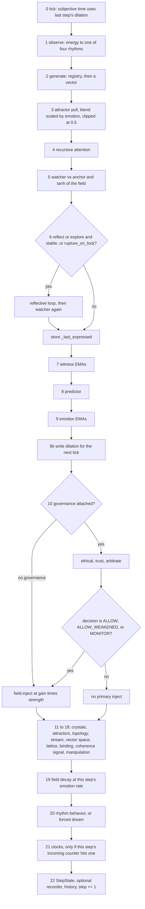
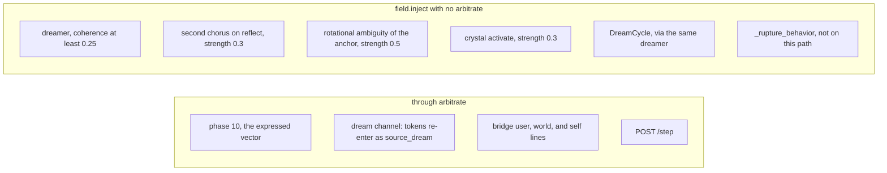
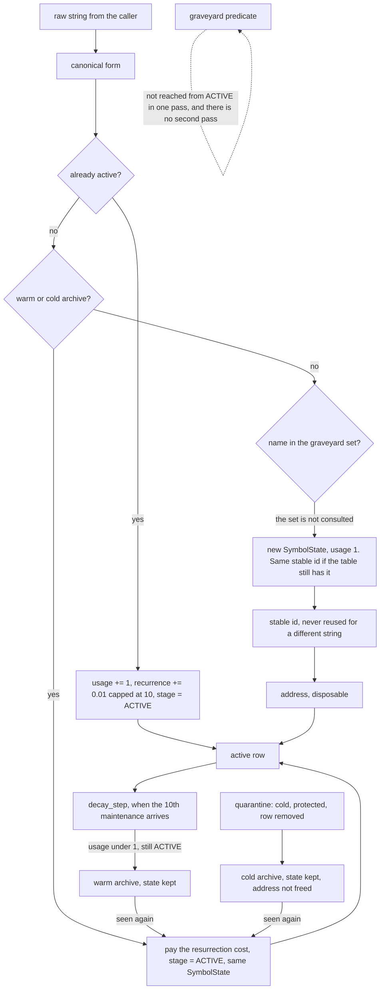

# Rubedo — flow

What moves, on which clock, and what a change reaches. The module index and the step's source order are [ARCHITECTURE.md](../ARCHITECTURE.md). Every numeric dial is the [census](EXPERIMENTAL_LEVERS.md#dial-census--every-numeric-lever). This page does not copy either. If a sentence here and the code disagree, the code wins.

A change is felt by whoever **reads** the state it **writes**, on the clock that write actually runs. "The field" is not one thing. The raw vector, the tanh view, the energy that picks a rhythm, and the coherence gauge are four different reads.

**Unwired is not dead.** A function or file with no caller is a parked hook unless this page says the live path cannot reach it. Do not delete one because it is absent from a chart. The standing list of parked hooks is in [ARCHITECTURE.md](../ARCHITECTURE.md#what-the-code-does-not-make-clear). The ones that sit on a flow below are marked **unwired** in place.

Numbers below are the live boot (`build_engine` → `CONFIG`, then `configs/*.yaml` for the keys CONFIG does not override). A test stack from `tests/_common.py` does not load YAML and does not pretrain. Say which boot you mean before comparing two runs.

---

## 1. State inventory

Process memory unless a checkpoint column says otherwise. Three serializers exist. They do not overlap.

| Serializer | When | What round-trips | What the next process does not have |
|---|---|---|---|
| `Generator.save_checkpoint` | `main()`, only if `session_persistence` (default **off**) | Encoder `state_dict`. Ecology JSON: active symbols, warm/cold/graveyard, stable-id table, address space, residency sets, compaction counts, `step_counter` | Field, crystals, attractors, witness, emotion, trust, bonds, stream, lattice, topology, watcher, predictor, attention window, dilation, governance signals. `_pending_compaction` is not in the JSON. `load_ecology` keeps the **live** Fix 0-B `_profiles` and `binding_leak`; the file does not restore them |
| `ValueEmergenceEngine.save_to_disk` | Same flag, same moment | Values, archived values, `symbol_to_value`, the engine step, its config | Sacred bits are re-applied on load because the engine asks governance to sanctify again. Nothing else in the table |
| `tools/voice/repl_qwen.py` `save_checkpoint` | The speech bridge's own scratch file, not `build_engine` | `cycle._step`, field vector, field injection history, `ve.serialize()`, `registry.to_dict()` | Witness, stream, crystals, attractors, trust, bonds, topology, lattice, phase history. Emotion is written (`arousal`, `valence`, `_step`) and **does not load**: those two names are properties, the assignment throws, and the `except` drops the whole emotion block. Registry restore is `__dict__.update` from `from_dict`, which sets `_profiles` back to `None` and `binding_leak` to `0` — unlike `load_ecology` |
| `StreamRecorder.dump_jsonl` | Same opt-in save, only if a recorder was attached | A log | Not read back into the loop |

`DELETE /reset/field` zeros the field vector and does not clear its history, the ecology, trust, or values.

### Field, step ring, time

| State | Lives | Written by | Read by | Bound | Restart |
|---|---|---|---|---|---|
| Raw field | `ResonanceField.field` | `inject`, `decay`, `diffuse`, `reset` | Energy (`\|\|field\|\|`), `resonate` → `tanh(field)`, the coherence gauge | length `dim` | Bridge checkpoint only |
| Injection history | `field.history` | `inject` (the pre-scale vector) | `internal_coherence` uses the last 32 | deque 256 | Bridge only |
| Phase history | `field._phase_history` | `inject` (FFT angles) | `phase_coherence` → dilation | deque 16 | No |
| Field step | `field._step` | `decay` only | `observe` | unbounded int | No |
| Rhythm thresholds | `field.thresholds` | `__init__` / YAML `field.rhythm_thresholds` | `current_rhythm` | four names, three cuts | No |
| Step counter | `AutonomousCycle._step` | end of `step` | phase-21 clocks, `StepState.step` | unbounded int | Bridge and, indirectly, not the ecology file |
| Step ring | `_history` | end of `step` | diagnostics | deque **1000** | No |
| Parent key | `_parent` | end of `step` | next topology edge | one string | No |
| Last expressed vector | `_last_expressed` | after the reflective loop | `DreamChannel`, `tools/decoder/listen`, `tools/dim256/lock_gate`. **Not** `step` | one vector | No |
| Boredom-override count | `_boredom_overrides` | `_rhythm_behavior` | status | unbounded int | No |
| Rupture hold | `_rupture_target`, `_rupture_fires` | only if `rupture_on_lock` is set (default **absent → off**) | the same block | one vector | No |

### Ecology

The registry is owned by `Generator`. `SymbolState` holds `usage`, `recurrence` (capped at 10), `centrality`, `attractor_strength` (cap 10), `crystal_binding` (cap 10), `field_coherence`, `diversity_credit` (EMA, only if Fix 0-B is on), ages, `reaper_stage`, `residency`, `protected`, `sacred`, `source_id`.

| Container | Bound | Restart |
|---|---|---|
| `symbols` (active) | unbounded dict | ecology JSON |
| `SymbolTable` stable ids | unbounded; ids start at 4 (the specials) and are never recycled | ecology JSON |
| `AddressSpace` | vocab 8192, grows at occupancy ≥ 0.85; free list only receives addresses from the graveyard branch | ecology JSON |
| Warm archive | cap 10_000, then 100 lowest-usage move to cold | ecology JSON (the `SymbolState`) |
| Cold archive | cap 50_000, then 500 names are dropped into the graveyard set | ecology JSON (the `SymbolState`, until that drop) |
| Graveyard | a **set of strings**, cap 100_000, then an arbitrary 5_000 names are deleted. The `SymbolState` is not stored | the set of names |
| Residency hot/warm/cold | no cap. Cuts are usage > 100 and > 10 | ecology JSON |
| `step_counter` | one int, incremented on **every** `register()`, including repeats | ecology JSON |
| Compaction plan | one report or `None`. Not serialized | lost |
| Fix 0-B profiles, `binding_leak` | off unless the lever is on | see the serializer table |

### Memory that is not the registry

| State | Lives | Written by | Read by | Bound | Restart |
|---|---|---|---|---|---|
| Crystals | `CrystalStore.crystals` | `maybe_crystallize`, `activate_nearest`, `decay_step` | stabilize reactivation, dreamer samples the store, manipulation's centroid cosine | 512, then weakest `stability * usage` | No |
| Attractor centers | `Attractor.centers` | `add`, `pull` (reinforce), `merge_pass`, `decay_step` | `pull`, the reflective loop's pull | 64 | No |
| Vector space | `VectorSpace._store` | `put` every step, and dreamer if `store_dreams` | dreamer sampling, lattice k-NN | **none** (`max_size` is `None`) | No |
| Topology | `TopologicalLog.graph` | `add` every step | no step reads it back. Diagnostics only | **none** | No |
| Lattice | `SemanticLattice.graph` | `add_node` every step; `emit_centrality` on the 100-step clock | centrality → `signal_centrality` on **active** symbols | 2048 nodes. `decay_edges` is **unwired** (no caller), so `edge_decay` is stored and unused | No |
| Concepts | `SymbolicBinding` | `bind` every step; `emit_centrality` on the same 100-step clock | centrality relay | 256 concepts | No |

### Identity, affect, prediction

| State | Lives | Written by | Read by | Bound | Restart |
|---|---|---|---|---|---|
| Witness short / mid / long / anchor | `Witness` | `update` every step, learning rate `(1 - decay) * clip(coherence², 0.01, 1)` | next step's watcher, explore/rupture mutation, stabilize's `activate_nearest`, dreamer | three vectors + one normalized blend (0.20 / 0.30 / 0.50) | No |
| Identity trace | `identity_trace` | `update` | no production caller of `recent_trace` | deque 256 | No |
| Snapshots, crystallization candidates, anchor-entropy deque | `Witness` | `update` when its own thresholds hit | no production reader. **Unwired.** This is not `CrystalStore` | snapshots and candidates are unbounded lists; entropy deque is 32 | No |
| Six emotion scalars | `EmotionalGradient` | `update` every step, one EMA α = 0.15 | `field_gain`, `mutation_scale`, `field_decay_rate`, `attractor_pull`, boredom override, arousal/valence → dilation, trust's stability input | each scalar in [0, 1] | No. The bridge file pretends otherwise; the load drops it |
| `dream_pressure`, `crystal_pressure` | computed, not stored | the two methods | `StepState.dream_pressure` and `modulation_snapshot` only. **Unwired** — no branch | — | — |
| Predictor weights | `PredictiveEcho._weights` | `update` every step after the second | curiosity / surprise / tension / boredom targets | history 8 × `dim`; error deque 32 | No |
| Attention window | `RecursiveAttention._history` | `refine` | the next refine | deque 16 | No |
| Watcher windows | `Watcher` | `evaluate` | temporal coherence, `report.stable` | three deques of 16 | No |
| Reflective-loop depth | no retained vector | `reflect` rewrites the candidate and returns it | the rest of this step | `max_depth` 5 passes, then discarded | — |
| Metastability windows | two monitors, default on | `observe` at stage A and stage C | `status`; `regime_state == "locked"` only if `rupture_on_lock` is on; diversity credit only if Fix 0-B is on | deque 128, recompute every 16 | No |

`arousal` and `valence` are not state. They are reads of the six scalars. Dilation is state, on the stream, written at the end of this step and consumed by the next `tick` only. Nothing in governance reads `subjective_time` or `dilation_factor`.

### Governance and values

All of this is absent unless `attach_governance` ran. `build_engine` does. A bare `AutonomousCycle` does not, and then phase 10 injects at full gain with no decision.

| State | Lives | Written by | Read by | Bound | Restart |
|---|---|---|---|---|---|
| Sacred id set | `GovernanceConstants` | boot (`3.12`, `11.88`, `280.90`, sanctified in the registry) and `promote_to_sacred` | ethical sacred-write check; reaper (`SymbolState.sacred` → always ACTIVE) | the set | the registry flags, via ecology JSON. The constants object is rebuilt at boot and re-sanctifies those three tokens; promoted ids come back only if values load and re-register them |
| Source trust, symbol trust | `TrustLedger` | `evaluate` (decay) and `receive_feedback` (the delta) | the next `arbitrate`; weakest of source and symbol wins | unbounded dicts. Histories: source deque 64, symbol deque 32, both **unwired** (append only) | No |
| Bonds | `RelationalBondManager._bonds` | `receive_feedback`, `notify_crystal`, `notify_attractor` | trust floor (`bond_strength × 0.40`), value bond-weights | unbounded dict. `decay_step` (**unwired**, no caller) would subtract `strength_decay` | No |
| Pre-bond counters | `_pre_bond` | every feedback | formation: interactions ≥ 20 and crystals ≥ 1, then the DDM (boot default on) or the classic quality read | per source | No |
| DDM variable | `BondFormationAccumulator` | per-source feedback while unbonded | an ACCEPT, still waiting on those two counts. The field never reads it | trace deque 64 per candidate | No |
| Dependency window | `DependencyMonitor._window` | feedback, **allowed** injections only | HHI → manipulation, the next arbitrate | deque 128 | No |
| Attractor monopoly counts | same monitor | `record_attractor` on a **new** center | `source_monopoly` | unbounded dict | No |
| Flood log | `EthicalBoundarySystem._injection_log` | the ethical check | flood gate, 60 s window | per-source deque, stale timestamps popped. Not a fixed maxlen | No |
| Manipulation windows | `ManipulationResistanceEngine` | phase 18b | `detect` → `_pending_signals` | deques of 32. Signals have **no TTL**; `arbitrate` consumes the list | No |
| `force_dream_flag` | `SelfhoodGovernance` | `arbitrate` when queued severity ≥ 0.90 | the **next** step's phase 20 | one bool | No |
| Audit log | `_audit_log` | `arbitrate` | status | 512 | No |
| `SystemRights` | a frozen object | never | never. **Unwired** | — | — |
| Values | `ValueEmergenceEngine.values` | every feedback | CORE handshake, status, bond-weighted decay inside the engine | 64 non-CORE; dissolved values move to `archived_values` and are not deleted | values JSON |
| CORE streak | `consecutive_core_eligible_steps` | `_check_core_promotion_candidates` | the handshake at ≥ 10 | per value; a rejection resets it to 0 | values JSON |
| λ ledger | only if `attach_lambda_ledger` | its own `decay` if something calls it | `solvent_gain` on productive-tension only. Not on the boot path | one scalar | No |
| ⊘ read / consumer | only if attached | the consumer, if attached, writes non-sacred value strength | `status` | — | No |

`agents/rhythm_config.json` matches the live energy cuts and is not loaded. Its per-rhythm gain, decay, and mutation are **unwired**. `interference/phase_noise.py` is **unwired**. `ReflectiveLoop.attractor_blend` is stored and never read; the pull uses `Attractor.pull_blend`.

---

## 2. One step

`step(tokens, source_id, origin_type)` does not tokenize. The caller passes a list of strings. Canonicalization happens inside `register`, and only when `generate` runs.

| Phase | Reads | Writes | Gate |
|---|---|---|---|
| 0 `tick` | `dilation_factor` from last step. First call only anchors the wall clock | `subjective_time` | — |
| 1 `observe` | `\|\|field\|\|`, FFT, phase history | nothing. Rhythm is a label | — |
| 2 `_generate` | tokens, rhythm, and on dream the mutation scale | registry rows; one vector. See the rhythm table | no |
| A | the generator vector | metastability window | — |
| 3 pull | emotion's attractor modifier, nearest center if cosine ≥ 0.75 | the candidate vector; may `signal_attractor` | no |
| 4 attention | its window, the candidate | the candidate; appends the pre-refine vector. Fix 0-B, if on, EMAs diversity credit onto each token | no |
| 5 watcher | candidate, witness anchor, `tanh(field)` | a `CoherenceReport`. `stable` means composite ≥ 0.40 | no |
| 6 reflective loop | only if `(rhythm is reflect or explore and stable)` or the opt-in lock hold | the candidate, then a second report. Does not write the field | no. The vector it produces is what phase 10 may inject |
| — | the candidate | `_last_expressed` | — |
| 7 witness | candidate, composite, energy | three EMAs and the anchor | no. Runs even if phase 10 will refuse |
| 8 predictor | candidate | weights, an echo report | no |
| 9 emotion | echo, composite, energy | six scalars | no |
| 9b | arousal, valence, `phase_coherence` | `dilation_factor` for the **next** tick | — |
| 10 | ethical check, trust, queued manipulation signals from the **previous** step's 18b | one `field.inject`, and only for ALLOW / ALLOW_WEAKENED / MONITOR, at `field_gain × strength`. `emit_feedback` runs even on a refusal | **yes, this inject only** |
| 11–18 | the candidate, the report, the relation profile | crystal (and a soft inject if one forms or reinforces), maybe an attractor center, a topology node, a stream entry, a vector-space entry, a lattice node, a concept touch, coherence onto the registry, manipulation signals for the **next** arbitrate | **no**. Refusal does not skip these |
| 19 | `field_decay_rate()` | `field *= rate`, then the field's own rate is restored | — |
| 20 | `force_dream_flag`, else the phase-1 rhythm, with boredom able to retarget | the extra writes in the next chart | **no** |
| 21 | the step counter as it was at entry | maintenance, merge, crystal and attractor decay, centrality. See [clocks](#3-clocks) | no |
| 22 | the locals above, including the **phase-1** rhythm and the **pre-decay** energy | `StepState`, the ring, `_parent`, `_step += 1`. Recorder if attached | the recorder stores the decision and never consults it |

`StepState.rhythm` is the phase-1 label. Boredom and `force_dream_flag` can make phase 20 do something else without changing that label. `StepState.field_energy` is from phase 1, before this step's inject and decay. `dream_pressure` is stored on the state and read by nothing that branches.

### What phase 2 does with the rhythm

| Rhythm | Vector | Registry class on a **new** symbol |
|---|---|---|
| stabilize | `generate` | `LANGUAGE` |
| dream | `generate`, then rotational `inject_ambiguity` on the vector, not on the field | `EPHEMERAL` |
| reflect, explore | `Chorus.harmonize` if chorus is on (boot default), else `generate` | `base` asks for `LANGUAGE`, later voices ask for `RELATIONAL` or `EPHEMERAL`. The class sticks only if this `register` **creates** the row. A string already in the table keeps the class it was born with |

Chorus runs six `generate` calls (base, skeptic, resonator, symbolic, dreamer, predictor) and collapses them. It does not inject. On **reflect**, phase 20 calls `harmonize` a **second** time. That is twelve `generate` calls, and twelve `usage += 1` bumps, for each token, on a reflect step.

### Where the gate is not

| Write | Gated? |
|---|---|
| Phase-10 inject | **Yes**, when governance is attached. No governance means the inject still happens, decision left at ALLOW |
| `dreamer.dream` | **No.** Its own bar is watcher composite ≥ 0.25. Strength is `0.4 × field_gain × 0.5` |
| Reflect's second chorus | **No.** Strength 0.3. A different vector from the one the gate saw |
| Explore's `inject_ambiguity(anchor, rotational)` | **No.** Strength 0.5. The docstring mentions phase noise; the call is rotational. `PhaseNoise` has no caller |
| `activate_nearest` (stabilize, top 3 around the anchor) and any phase-11 crystallize/reinforce | **No.** Soft inject at 0.3. Phase 11 runs even when phase 10 refused |
| `rupture_on_lock` mix | **Not an inject.** The mixed vector continues into phase 10 and **is** gated. Default off |
| `_rupture_behavior` | **No**, and not in `_rhythm_behavior`. Direct callers only |
| `DreamCycle.run` | **No.** Same dreamer, plus `diffuse(0.03)`, plus its own `maybe_crystallize` |
| Dream channel | **Yes.** It only decodes `_last_expressed`. `main` steps the tokens as `source_dream` / `origin_type="internal"` with probability 0.20 |
| Bridge `you` / `world` / `self` | **Yes.** Ordinary `step` calls. The bridge does not use `build_engine`; see ARCHITECTURE |
| `POST /generate` | No step, no inject. It does call `generate`, so it **does** register tokens |
| `POST /step` | **Yes** |
| Stabilize `diffuse` | Not an inject. On by default, α = 0.05 |

Boredom with Teeth: if `boredom > 0.50` and the phase-1 rhythm is not already explore, phase 20 pretends the rhythm is explore. It increments `_boredom_overrides`. It does not run when `force_dream_flag` already took the dream branch. It does not rewrite `StepState.rhythm`.

`force_dream_flag` is set in `arbitrate` from the previous step's signals and cleared at the end of `_dream_behavior`. One shot, next step, ungated dream injects.

### The lock is the identity integrator

The field sitting near 0.998 coherence is a measured pin, not a literal. The gauge is `ResonanceField.internal_coherence`: cosine of the raw field against the mean of the last 32 injection-history vectors, mapped from [−1, 1] into [0, 1]. The census marks that gauge. Do not "fix" the pin, and do not confuse it with attractor `decay_rate` 0.998, identifier `base_decay` 0.998, or the metastability label `_LOCKED_COH` 0.80. This page did not remeasure the pin.

The mechanism, from the code:

1. On reflect or explore, once the watcher says `stable`, `ReflectiveLoop.reflect` runs up to 5 passes.
2. Each pass pulls the candidate toward the nearest attractor, then blends it 10% toward `tanh(field)` (`field_blend` 0.10) and renorms. The field snapshot is taken once, before the loop. The loop does not write `field.field`.
3. It stops when successive candidates have cosine ≥ 0.995, or when coherence falls under 0.20 after the first pass.
4. With novelty attenuation on (the `build_engine` default; the class default is off), a final mix pushes back toward the raw candidate, capped at 0.30.
5. That vector is what phase 10 adds into the raw field. Decay then multiplies the raw field by a rate near 0.995 (emotion can move it inside [0.97, 0.9999]). Aligned additions do not cancel, so energy stays in the reflect band the thresholds were cut to hold (the field comment records that equilibrium near 292–294, under the 300 cut).

The next step's rhythm is that energy, not the coherence gauge. The integrator holds identity because the vector allowed into the field has been aimed at the field. Metastability, if you want more of it, is a property of this reconstitution, not a defect in `ResonanceField`.

Three different "locked" tests exist. They are not interchangeable:

| Test | What it actually is |
|---|---|
| `internal_coherence` near 0.998 | the pin. A gauge. Nothing branches on 0.998 |
| `report.stable` (composite ≥ 0.40) | what lets the reflective loop run on reflect/explore |
| stage-A `regime_state == "locked"` (`_LOCKED_COH` 0.80) | what `rupture_on_lock` requires, and that lever is off |

---

## 3. Clocks

Phase 21 reads `_step` **before** `_step += 1`. `_step` starts at 0, so interval `K` first fires on the call that begins with `_step == K`, which is the `(K+1)`th call. A harness of `N` calls only sees counters `0 … N-1`.

`main()` has a **second** counter, also named `step`, starting at 0, tested before it increments. Dream-cycle `% 20` uses that one, not `cycle._step`.

| Clock | Period or trigger | What changes | At harness scale (about 100–800 steps) |
|---|---|---|---|
| Generator `maintenance_step` | incoming `_step` ∈ {200, 400, …}. CONFIG 200 | increments `_maintenance_count`. Does **not** by itself decay | 3 fires in 800 one-step calls. 0 in 100 |
| Auto maintenance | every 500 `generate` **or** `encode_batch` calls. CONFIG 500 | the same `maintenance_step` | one fire if each step calls `generate` once. Sooner under chorus. See below |
| Registry `decay_step` | every 10th `maintenance_step`. CONFIG `decay_interval` 10 | usage, reaper stage, archive moves, maybe a compaction plan | **not** on the one-`generate`-per-step path inside 800 calls. Arithmetic below |
| Attractor `merge_pass` | incoming `_step` ∈ {50, 100, …}. YAML `cycle.merge_interval` is the live 50. Also once at the end of `DreamCycle` if merge is on | centers with cosine ≥ 0.95 collapse. The stronger absorbs the weaker | yes |
| Crystal `decay_step` and attractor `decay_step` | incoming `_step` ∈ {100, 200, …}. YAML `crystal_decay_interval` 100. Dream cycle also decays crystals, not attractors | crystal usage `*= 0.9995`, drop under 0.01. Attractor usage `*= 0.998`, strength `*= 0.9995`, drop usage under 0.1 | the **call** fires. A crystal that starts at usage 1.0 and is never reinforced needs on the order of 10⁴ of these calls to fall under 0.01. A harness does not kill crystals or centers this way |
| Lattice and binding centrality | same 100-grid, YAML `lattice_emit_interval` | `SymbolState.centrality` on symbols **still active** | yes, as a write. It cannot reach an archived symbol |
| `SemanticLattice.decay_edges` | none. No caller | would multiply edge weights by 0.999 | never |
| `RelationalBondManager.decay_step` | none. No caller | would subtract 0.0005 from bond strength | never. Bonds move on feedback, not on a clock |
| Dream cycle | `main` only: rhythm equals `dream_cycle_trigger` (`stabilize`) and the driver's counter is 20, 40, 60, … . `n_iterations` is CONFIG 6. `POST /dream` and the socket `dream` command call it directly (`n_iterations` 4 on the HTTP path) | dreamer injects, `diffuse(0.03)`, a crystallize offer, attractor merge, crystal decay | only while energy is still under 5. That is the cold-start band. The YAML key `trigger_every_n_steps` is **not read**. The 20 is a literal in `main` |
| Dream channel | `main` only, probability 0.20, after the first step has stored a vector | a normal governed step as `source_dream` | probabilistic. Not on the API, the socket, or the bridge |
| Value decay and the CORE streak | **every** governed step, inside `evaluate_experience` | strength `-= 0.0008` (bond-weighted), polarity, maybe a promotion request | per step, not a slow clock |
| CORE handshake | when strength has stayed ≥ 4.50 for 10 **consecutive evaluations** | `review_core_promotion`, and on approval `sanctify` + sacred set | the streak is real. Approval also needs field-alignment ≥ 0.5, and more than one contributing source **or** `dream_reinforced_count > 0`, and no pending manipulation signal naming a contributor. A rejection zeros the streak |
| Trust decay | every `evaluate`, i.e. every governed step | `trust_score -= 0.003 * (1 - emotion.stability)`, clipped to [0.1, 5] | per step |
| Manipulation signals | queued at 18b, consumed at the next `arbitrate`. No TTL | the next decision, and maybe `force_dream_flag` | the windows fill in a few dozen steps |
| Emotion EMAs | every step, α 0.15, one α for all six | the scalars | every step |
| Witness EMAs | every step | the anchor | every step. Decays 0.85 / 0.97 / 0.995 are the census's; the shape is fast context, slower narrative, slow identity, coherence² as the learning rate, floored at 0.01 |
| Dilation | every step, one step late | the next tick's `subjective_time` only | every step. `k_agitation` ships at 0, so the chaotic-field term is present and multiplied by zero |
| Predictor | every step | weights | learning starts once two vectors are in the window |
| Step log | CONFIG `log_interval` 5 (this overrides YAML's 10) | a log line | not state |
| `POST /maintenance` | explicit | one `maintenance_step` (still subject to `decay_interval`) | only if something calls it |
| Vector space, topology | every step, no cap | growth | an 800-step run does not evict |
| Lattice node cap | on `add_node`, past 2048 | prune the weakest node | not inside 800 steps |
| Warm / cold / graveyard caps | on archive writes, not on a timer | tier moves. Cold overflow drops names into the graveyard set and does **not** reclaim addresses | not at harness scale. 10_000 and 50_000 |
| Audit log | past 512 governed steps | drops the prefix | only on a long governed run |

`configs/attractors.yaml` `decay_profiles` and `constants` are loaded into the merged dict and intentionally not applied. Editing them changes nothing. `Attractor.formation_threshold` is stored from that file and **not read by `add`**. The live gate is the cycle's `attractor_formation_threshold` (YAML `cycle`, same 0.88 today). Two knobs, one of them unwired.

### When the reaper actually runs

`decay_step` is not "every 200 steps." It is every 10th call to `maintenance_step`, and those calls come from two places that share one counter: phase 21, and `generate` / `encode_batch` every 500 calls.

Boot pretrain does not spend that counter in bulk. The training step uses `encode_grad`, which registers tokens and does **not** call auto-maintenance. The accuracy eval calls `encode_batch` once, and only when `(epoch + 1) % 5 == 0`. CONFIG asks for 8 epochs, so that is **one** tick, during epoch 5. The loop then starts with `_call_count == 1`.

On a path with **one** `generate` per step (stabilize, dream, or chorus off), 800 `step()` calls produce 3 phase-21 maintenances (`_step` 200, 400, 600) and 1 auto maintenance (the 500th `generate`, which arrives one call earlier because boot already ticked once). Total 4. `4 % 10 ≠ 0`, so `decay_step` has not run. The 10th maintenance is the auto fire on the **1500th** `step()` call (incoming `_step == 1499`). "Dormant under ~800 steps" is true for this shape. 800 is not a constant in the code. 1499 is the bound for this shape.

It is not true for every shape. A reflect step with chorus calls `generate` six times in phase 2 and six more in phase 20. Explore with chorus calls it six times (phase 20 does not generate). If every step were reflect, the 10th maintenance lands a few hundred steps in, not at 1500. A real `main()` warms up in dream (one `generate`) and then sits in reflect (twelve). How many `generate` calls have happened is the missing input for a single step number. Count `_call_count` and `_maintenance_count` rather than the step index.

### What one decay pass can do

`step_counter` advances on every `register()`, not once per cognitive step. By the time the first `decay_step` runs, `minimum_lifespan` is already behind anything registered at boot. That lifespan is 10 registration events for `LANGUAGE` and 5 for `IDENTIFIER`. Corpus words born in pretrain are `IDENTIFIER`. The distinction does not matter for the bound below: both lifespans are long past.

For an unseen symbol with no binding signals, one pass does `usage *= effective_decay`, and `effective_decay` is at least 0.01. A symbol that is still active has usage ≥ 1 (otherwise an earlier pass would already have archived it). One pass from there cannot produce `usage < 0.01`. The graveyard predicate is strict `< 0.01`, and it also requires the symbol's current stage to already be `COLD`.

From `ACTIVE`, the same pass returns:

- `WARM` if usage has fallen under 1.0, which a single multiply by 0.999 does, or
- `COLD` only when usage is already under 0.01 **and** the stage is still `ACTIVE` — which the floor above blocks for a symbol that entered the pass at usage ≥ 1.

The symbol is then **removed from `symbols`**. Later decay passes do not see it. `max_warm_steps` (500) and `max_cold_steps` (1000) are written against `state.age`, and they only apply to a symbol that is still in the active dict while its stage is already warm or cold. The live loop never leaves a symbol in that condition: the pass that sets the stage also removes it. Quarantine sets `COLD` and deletes the active row in the same call.

So the graveyard branch, which is the only caller of `AddressSpace.reclaim`, does not run on the live cycle. Compaction, which waits on a non-empty free list and fragmentation ≥ 0.30, does not run either. Cold overflow at 50_000 names can put a string in the graveyard set without reclaiming the address. That cap is not a harness event.

A token that is still being said cannot archive. Every `generate` does `usage += 1` before any decay. Chorus on reflect does that twelve times a step. Decay is a rare multiply. Traffic wins.

### Crystallization is not a clock

Phase 11 runs every step. A new crystal needs all three: composite ≥ 0.75, crystallization pressure (geometric × temporal) ≥ 0.60, and witness **long** relation ≥ 0.80. A cosine ≥ 0.92 against an existing crystal reinforces instead. `crystal_pressure()` does not scale these. **Unwired.**

The dreamer's own offer passes `long_relation=0.5`. `DreamCycle`'s offer passes `0.6`. Both are under 0.80, so neither call creates a crystal under the default gate. The value engine's dream boost looks for crystals **appended during** `dreamer.dream`. That list does not grow. The hook runs; the offer cannot feed it. Live crystals come from phase 11, then stabilize reactivates the nearest three.

### Value evaluation is every step, and the streak is 10

`core_consecutive_required` is 10. The counter increments once per `evaluate_experience` while `strength ≥ 4.50`, and `evaluate_experience` runs once per governance feedback, which is once per governed step. It is not a window of 10 cognitive steps measured some other way, and it is not 10 dream cycles. Missing the strength bar, or a refused handshake, zeros it.

Dissolved values are archived, not deleted. CORE values (`promoted_to_sacred`) cannot dissolve. The cap of 64 dissolves the weakest non-CORE emergent or weak values first.

---

## 4. One symbol's life

| Stage | What the code does |
|---|---|
| Canonical form | Pipeline, in order: special-token halt (`<PAD> <UNK> <BOS> <EOS>`), NFKC, strip, empty → `<UNK>` and halt, glyph halt, operator classify, alias (`c++` → `cpp`, and the other four in the dict), identifier classify, entity if it looks like a capitalized word, else lowercase. Entities and glyphs keep case. Class from the pipeline is the default; `generate`'s `token_class` overrides it **only when the row is created** |
| First sight | `register` → `get_or_create_sid` → `resolve_sid`. Boot governance has already registered `3.12`, `11.88`, `280.90` as `ENTITY` and sanctified those three ids, plus a separate unsanctified row for each meaning alias (`THE_BRIDGE`, `THE_DISCIPLINE`, `HOMEOSTATIC_RETURN`) |
| Stable id | Permanent for that canonical string. Not moved by compaction. Not recycled after reaping. A second string never receives it |
| Address | The embedding row. Specials are identity-mapped. Otherwise the free list, else a fresh slot. Compaction may remap it. The stable id does not follow the row |
| Class | Fixed at creation. An explicit `token_class` beats the pipeline only on that first `register`. A plain word matches the identifier tier (the tier does not halt), so a `token_class=None` registration — pretrain's `encode_grad` is one — stores `IDENTIFIER`, not `LANGUAGE`. `build_engine` pretrains before the loop, so corpus words are already `IDENTIFIER` when chorus later asks for `LANGUAGE`. Dream mints `EPHEMERAL` only for a string that has never been registered. Chorus's later voices do not reclassify anyone |
| Usage | `+= 1` on every `register` of an active symbol. Decay multiplies, on the slow clock above. Binding signals add to the reinforcement term inside that multiply. The weights are per class in `DECAY_PROFILES`; the census has the table. Fix 0-B, off by default, adds `diversity_credit` there |
| Protected | `protected` flag, or class ∈ {GLYPH, ENTITY, SPECIAL}. The reaper's graveyard return is replaced with `COLD`. Warm and cold are still allowed. `SPECIAL` also has lifespan 999999 and `base_decay` 1 |
| Sacred | `sanctify_symbol` sets `protected` and `sacred`. `evaluate` returns `ACTIVE` immediately. Boot does this for the three constant tokens. CORE promotion is the other writer. A sacred **write** is refused by the ethical gate (`SACRED_SHIELD`); that is a different check from the reaper flag, and it keys off the sacred id set |
| Quarantine | Governance, not the reaper. Sets `protected`, forces `COLD`, removes the active row. Address is kept. Seeing the string again resurrects it from cold (cost +5 usage) and **does not clear** `protected` |
| Warm | State object kept. Address kept. Seeing it again costs +2 usage and returns it to active |
| Cold | Same, cost +5. Population overflow can discard the state and keep only the name |
| Graveyard | `bury` stores the **name only** and `reclaim`s the address. `lookup` does not search this set, so the next `register` does not pay a cost and does not restore the old state. It allocates a fresh `SymbolState` on the **old** stable id, with a new address (possibly the one just freed). The name can sit in the graveyard set and in `symbols` at the same time. Nothing in `register` removes it from the set |
| Compaction | Planned inside `decay_step` if fragmentation ≥ 0.30, applied on a later `maintenance_step` by copying embedding rows. Stable ids stay. This waits on `reclaim`, which waits on the graveyard branch |

Residency (hot / warm / cold by usage) is a label on the row. No caller reads it to change a step.

---

## 5. If this changes, these feel it

One hop is a direct read of the thing you changed. Two hops is a read of something that read it. Dial magnitudes stay in the census. This is the reach.

### Field width

Live home is `CONFIG["dim"]`. The leftover sites that must move with it are the census and `tests/doc_accuracy/hardcoded_dim.py`. A checkpoint does not survive a width change: the bridge load skips a field vector whose shape disagrees, and `tools/dim256/` refuses the live 128 filenames.

| Hop | Feels it |
|---|---|
| One | Every vector allocated at `dim`: field, witness layers, crystals, attractor centers, stream, vector space, predictor weights `(history, dim)`, attention, generator embedding, decoder, perception `W`. Cosine gates do not contain a `dim` literal; they still compare vectors of this length |
| Two | Rhythm. Energy is `\|\|field\|\|`, so the same per-coordinate magnitude is a larger number in a wider field. The cuts 5 / 150 / 300 were checked at 64 and 128, which agreed. They are not a proof about 768. A wider field that changes energy changes `_generate`, phase 20, and the dream-cycle trigger. The reaper does not read `dim`. The coherence **gauge** is a cosine, so it does not scale with width the way energy does |

### Rhythm selection

Today this is one number, energy, cut into four bands. There is no fifth branch.

| Hop | Feels it |
|---|---|
| One | `_generate` (class, chorus or not, dream-time ambiguity), phase 20's extra inject or diffuse, `StepState.rhythm`, the stream tag, the topology metadata, the dream-cycle equality test. Boredom can still override phase 20 without changing the recorded label. `force_dream_flag` can still override it the other way |
| Two | The next step's energy, because phase 20 and phase 10 write the field and phase 19 decays it. Token class, only for strings that do not exist yet. Witness, emotion, and the gate still run on every band; they do not switch off because the label changed. Loading `rhythm_config.json` would be a new write path: nothing in the step reads it today, so its modifiers are not a hidden second selector |

### Emotion scalars

| Scalar's outputs | One hop | Two hops |
|---|---|---|
| curiosity, wonder, tension | `field_gain` (phase-10 strength, and the dreamer's strength), clipped to [0.1, 3] | inject magnitude → energy → next rhythm |
| wonder, curiosity, joy | `mutation_scale`, clipped to [0.001, 0.5] | dream-rhythm ambiguity, explore's inject, chorus skeptic scale, and `_rupture_behavior` if something calls it |
| tension, stability | `field_decay_rate` for this step only, inside [0.97, 0.9999] | next energy → next rhythm. Also trust's per-step decay, which shrinks as stability rises |
| joy, curiosity | `attractor_pull`, clipped to [0.5, 2], then the blend is clipped again at 0.5 | how hard phase 3 and the reflective loop pull. That vector is what the gate injects |
| boredom | phase-20 override to explore above 0.50 | an ungated explore inject on a step whose recorded rhythm is not explore |
| all six, via arousal and valence | dilation | the next tick's `subjective_time` only. Terminal |
| dream pressure, crystal pressure | a number on `StepState` or a snapshot | nothing. **Unwired** |

### Trust

| Hop | Feels it |
|---|---|
| One | `arbitrate`'s choice and strength. The ethical check's picture of the source. The weakest symbol-trust pulls the source down. A bond puts a floor under later decay (`bond_strength × 0.40`) |
| Two | The decision's feedback: the dependency window (allowed decisions only), the bond manager, the value engine's strength update, and the manipulation signals that the **next** `arbitrate` will see. A refusal skips phase-10 inject and does **not** skip phase 11–20, so a low-trust step can still soft-inject a crystal, seed an attractor, and run the rhythm behavior. That is the two-hop that surprises people who think the gate is the whole write path |

### Reaper thresholds

`warm_threshold` 1.0, `cold_threshold` 0.1, `graveyard_threshold` 0.01, lifespans and the per-class decays live on `ReaperConfig` / `DECAY_PROFILES`. YAML `decay_profiles` does not override them.

| Hop | Feels it |
|---|---|
| One | The stage `evaluate` returns, **on a pass that actually runs**. Resurrection cost (+2 warm, +5 cold). Not the next cognitive step, unless that step happens to be the 10th maintenance |
| Two | A warm or cold row is invisible to `signal_centrality`, `update_field_coherence`, and the active decay loop until something `generate`s the string again. A graveyard reclaim, **if a pass ever took that branch**, would put the address on the free list, and the next new symbol could inherit the embedding row. On the live cycle that branch is not taken, so tightening `graveyard_threshold` currently changes a predicate the loop does not reach. Tightening `warm_threshold` does change the first pass, once the first pass exists. Sacred and protected do not change the warm move; they only replace a graveyard return with cold |

### A few other reaches that look like dials and are not

| If you change… | One hop | Two hops |
|---|---|---|
| `Attractor.formation_threshold` in `attractors.yaml` | the stored attribute | nothing. `add` does not read it. Change `cycle.attractor_formation_threshold` |
| `edge_decay` | the stored attribute | nothing, until something calls `decay_edges` |
| `bond` `strength_decay` | the stored attribute | nothing, until something calls `RelationalBondManager.decay_step` |
| Dream-cycle YAML `trigger_every_n_steps` or `trigger_rhythm` | the file | nothing. `main` reads `CONFIG["dream_cycle_trigger"]` and a literal `% 20`. `n_iterations` in CONFIG is live (6); the class default of 8 is not |
| `crystal_pressure` | the snapshot | nothing. Crystallization reads the watcher and the witness long relation |
| Phase-10 decision | that one inject, the feedback fan-out | not the phase-20 inject, not the crystal soft-inject, not witness, not decay |

---

## What this page did not pretend to settle

- The exact `step` index of the first `decay_step` on a real `main()` run. It depends on how many of those steps are reflect. The one-generate bound is the 1500th call. The every-step-is-reflect bound is a few hundred calls in. Count the two counters.
- Whether `internal_coherence` is still near 0.998 on today's weights. The gauge and the mechanism are in the code. The number is the recorded pin.
- Every diagnostic script that calls `field.inject` on its own. The production writes are phase 10, phase 20, crystal activation, `DreamCycle`, and the HTTP `dream` command. A tool that builds a field and injects is not on this path.
